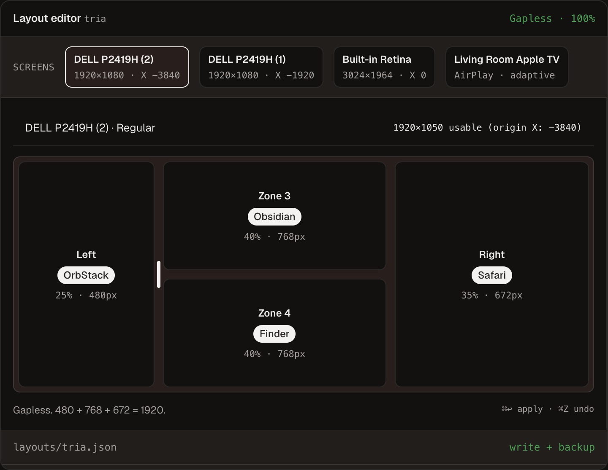
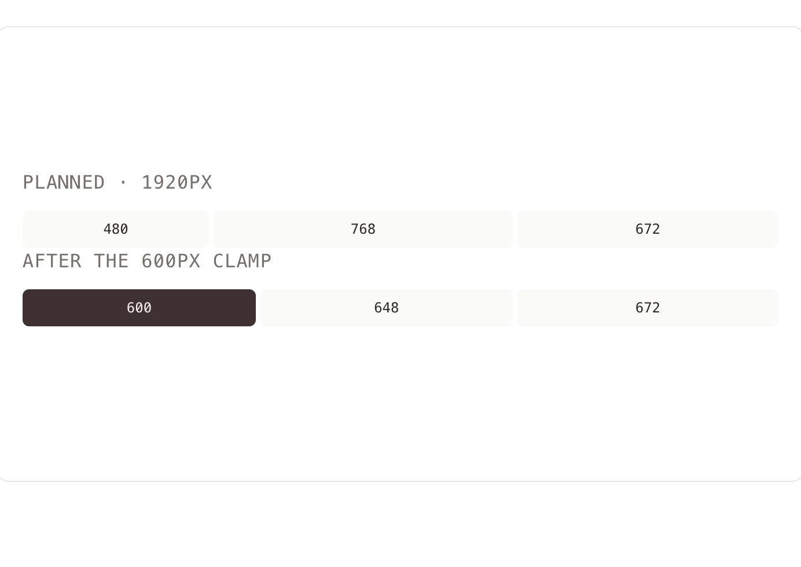
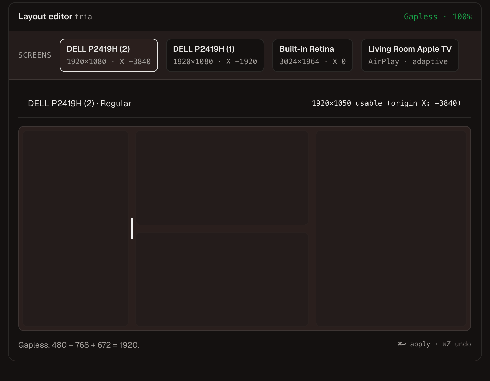

**Coffer** is a menu-bar window manager for macOS 14. You draw a named layout on a picture of the monitors. The file lives in `~/.config/coffer/` next to the rest of the dotfiles.

Rectangle throws one window to the left half. `yabai` and Aerospace will run the whole desk if you live in them. I wanted three named workspaces I could see, keep in git, and apply on Monday without rebuilding the same arrangement by hand.

The product is at [coffer.magio.ie](https://coffer.magio.ie).



```text
~/.config/coffer/
├── config.json
├── layouts/
│   └── <layout-id>.json
└── backups/
    └── last-known-good/
```

## Why I built it

The desk is a MacBook and two identical Dell P2419Hs. Coding, Review, and iOS Debugging are the same every week. I was still dragging the windows.

Saved layouts in Rectangle sit in a Settings table. You cannot diff them. You cannot put them in a repo. A tiling window manager would remember the arrangement, and it would also want to own every resize from then on.

The windows themselves do not do what you ask. OrbStack will not go below 600px. Ask for 25% of a 1080p Dell (480) and it sits at 600 anyway, overlapping Obsidian. Safari in Full Screen grows a second 90px toolbar window at the same origin. Unplug one Dell and macOS drops the `(1)` from the name of the one that stays.

So apply reads the frame after the move. If an app clamps, the neighbor shifts. Displays match on hardware UUID, not the label.



Regular is the MacBook on the road. Work is the Dells at the desk. Same layout name, two physical setups.

## Tech Stack

- **Swift and SwiftUI** — menu bar popover and the layout editor
- **AppKit Accessibility** — move the window, read the frame back, wait out Dock and Full Screen animations
- **JSON in `~/.config/coffer/`** — layouts plus a last-known-good backup if a hand-edit fails to parse
- **Local MCP** — dock Simulator next to Cursor, then put the previous frames back

## What it does

- Split, merge, and drag dividers on the actual monitors, then apply with ⌘↩
- Regular for the laptop, Work for the Dells, one undo for the whole desk
- If an app refuses to shrink, the neighbor moves so nothing overlaps
- A dark shield on a monitor for a screen share. Esc clears it. The app stays open
- Bind a layout to a macOS Focus Mode. Work Focus can apply the Work desk. Deep Work can raise the shields.

## Tell an agent

Coffer's MCP server talks in desks, not pixels. In Cursor I can say the thing I mean:

```text
Put OrbStack, Obsidian, Finder, and Safari on the left Dell.
```



A layout can bind to a Focus Mode in the editor. Then the agent only has to name the mode:

```text
Switch to Work Focus.
```

Work Focus applies the layout I bound to it — usually the Work desk on the Dells. Deep Work applies Coding and can darken the other monitors. When the task is done:

```text
Put the desk back.
```

Same apply path as ⌘↩. The agent does not compute coordinates. Coffer reads the real frames, and undo restores the previous ones.
