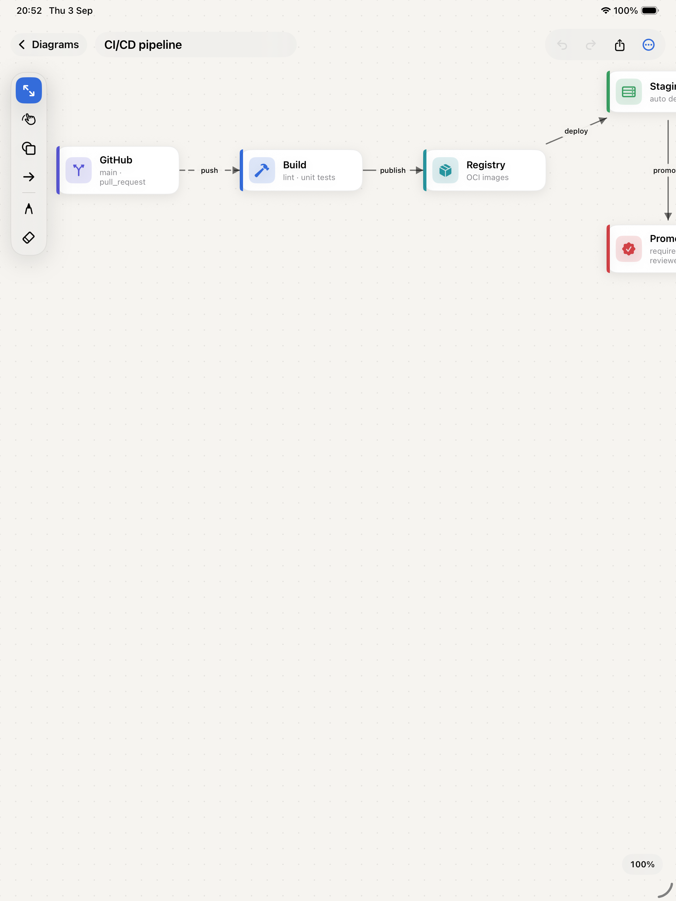
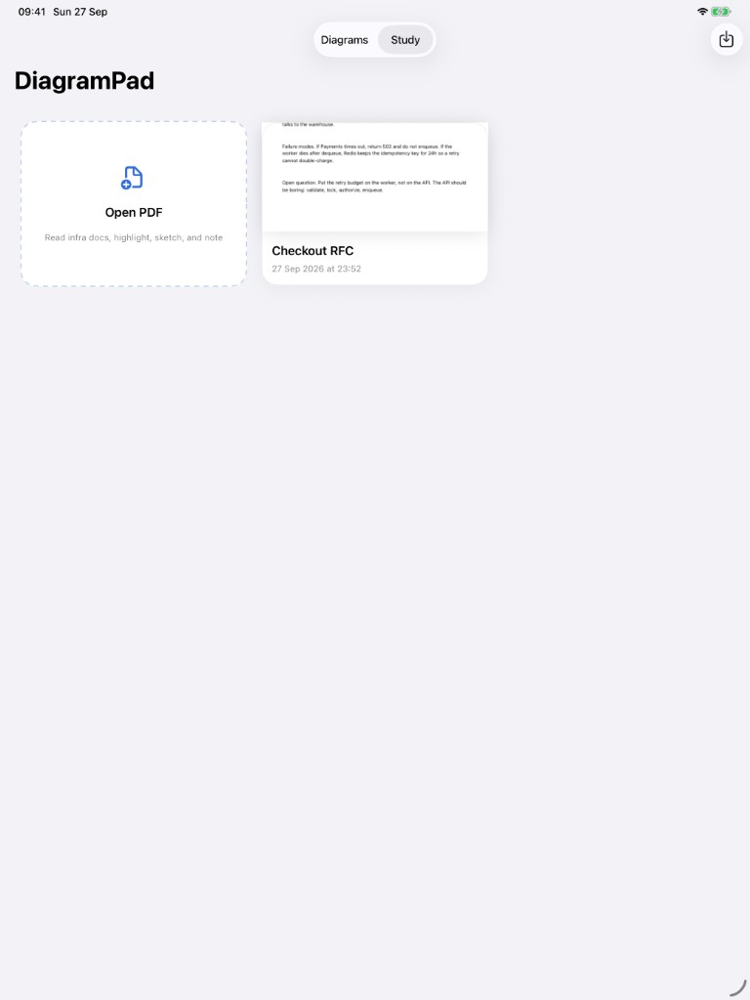
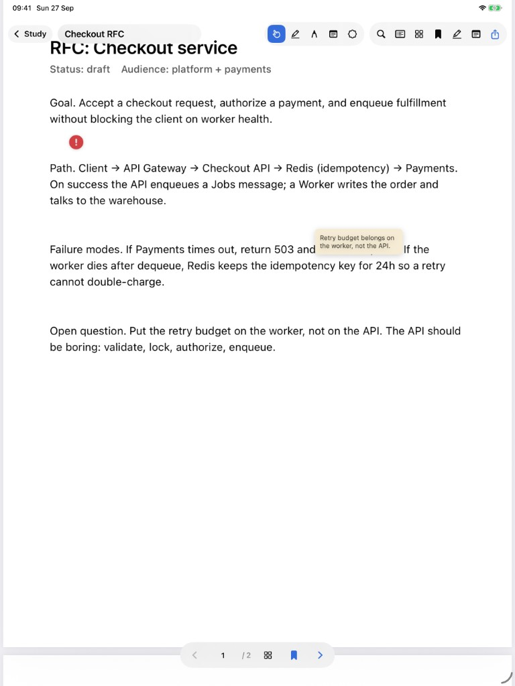

**DiagramPad** is an iPad app for engineering diagrams. Architecture, data flow, CI/CD. When the brief is a PDF, it opens on the same canvas.

A laptop and a whiteboard are the wrong size on the train. I wanted boxes, arrows, and Pencil notes I could export as a PNG before the RFC.

## Why I built it

Design reviews still start as boxes and arrows. I was bouncing between Files, a drawing tool, and a laptop that would not sit on a tray table.

Place a client, a gateway, a service, a store. Wire them. Label the edge. Ship a PNG into the doc. When the architecture brief arrives as a PDF, open it in Study, ink on top, leave a sticky. Same session. No second app.

The diagrams stay on the device. There is no backend.

## Tech Stack

- **SwiftUI** — iPad-first canvas and library
- **SwiftData** — diagrams on device
- **Apple Pencil** — freehand on the same board as the boxes
- **PDFKit** — open the RFC next to the diagram

## What it does

- Architecture parts: client, gateway, service, database, cache, queue, storage, external
- CI/CD parts: repo, runner, artifact, environment, approval
- Study mode for PDFs, highlight, ink, and notes
- PNG export you can paste into the writeup
