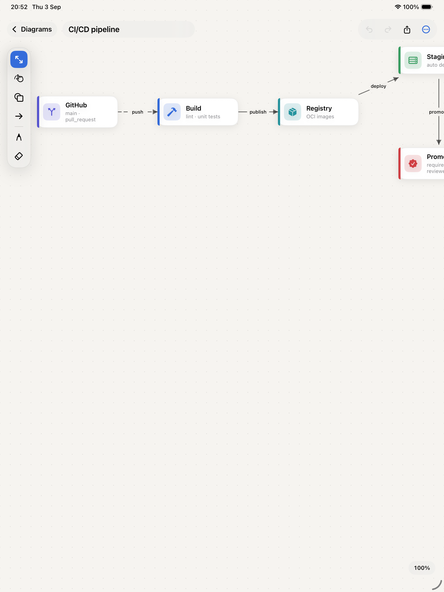
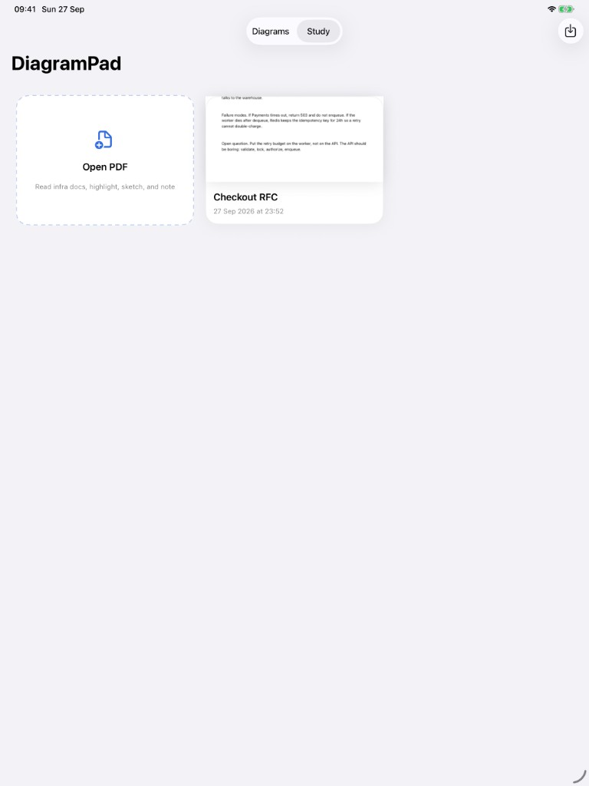
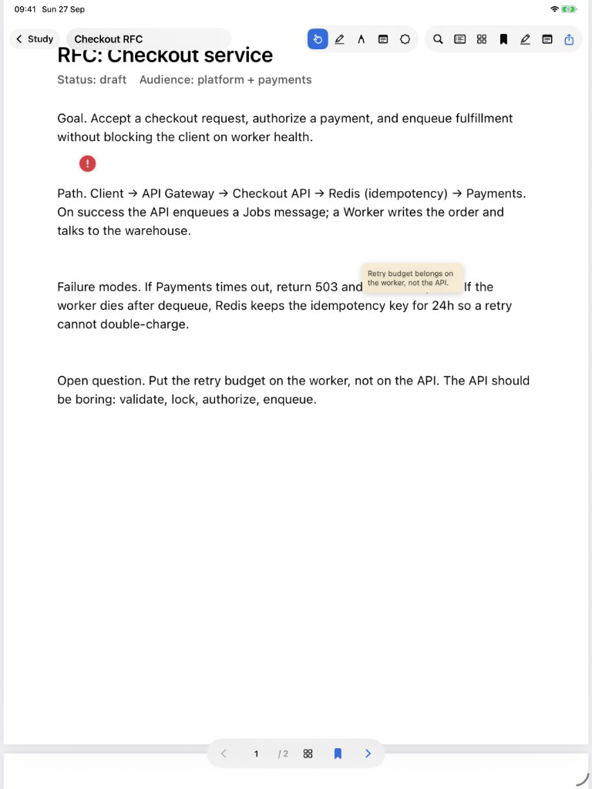

**DiagramPad** is a lightweight iPad app for engineering diagrams: architecture, data flow, and CI/CD pipelines. You can open PDFs on the same canvas when the source material is a document, not a blank board.

Sketch the system on your iPad before you write the RFC.

## Screenshots

A starter CI/CD pipeline:

Study mode — open PDFs, highlight, sketch, and note:

Reading an RFC with ink and sticky notes:

## Why I built it

Design reviews still start as boxes and arrows and a laptop or whiteboard is the wrong form factor when you're on the go. DiagramPad is the thin path: place components, wire them, label the edges, ship a PNG. When the brief arrives as a PDF, open it in the app and sketch on top of the same session instead of bouncing between Files and a drawing tool.

## Tech Stack

- **SwiftUI** — iPad-first canvas and library UI
- **SwiftData** — diagrams stay on device; no backend
- **Apple Pencil** — freehand notes on the same canvas as boxes and arrows
- **PDFKit** — open and read PDFs alongside the diagram canvas

## What you can place

**Architecture** — Client, API Gateway, Service, Database, Cache, Queue, Storage, External.

**CI / CD** — Repo, Runner, Artifact, Environment, Approval.

**Notes** and freehand ink

## Key Features

- **Design review prep** — clients, gateways, services, caches, and stores before the RFC
- **CI/CD design** — runners, artifacts, environments, and promote paths
- **PDF reading** — open a PDF in Study mode when the architecture brief is a document
- **Pairing and teaching** — share the iPad, talk through a flow, leave notes on the canvas
- **PNG export** — something you can paste into the doc without a desktop tool fight
