**Treage** explains one failed shell command and offers a next diagnostic step. It does not run that step.

```bash
python3 -m treage run -- kubectl get pods -n payments
```

Exit `0` prints the command's output and keeps nothing. A non-zero exit keeps a bounded tail of `stdout` and `stderr` in memory, scrubs likely secrets, and prints an evidence-grounded diagnosis after the command's own output. The process exit code stays the command's exit code.

With no model configured, common failure shapes (`Forbidden`, `NXDOMAIN`, local `Connection refused`, permission denied) get a deterministic read-only hint (`kubectl auth can-i`, `getent hosts`, `ss -ltn`, `ls -ld`). When `--runtime ollama` is enabled, the local model's completion goes through the exact same redaction, substring-grounding, and shell-policy checks as an offline fixture.

Tonight's build notes live on the [[canvas/treage | Treage canvas]].

## Why I built it

The first ten minutes of an incident are mechanical and dangerous: gather the next missing fact, pick a read-only check, and do not destroy forensic state under stress. Restarting a pod that exited `137` (`OOMKilled`) wipes `lastState.terminated` before anyone reads it. Guessing `ss -ltn` when `curl` refused a remote IP checks the wrong machine.

AI terminal assistants can speed up that loop, and most of them fail two tests before an SRE or security team will let them near production:

1. **They capture everything.** Always-on shell hooks record every command and every `exit 0` output for "context." That is a keylogger with good intentions.
2. **Their safety boundary is a prompt.** Writing *"never suggest destructive commands"* in a system prompt is a polite request. An indirect prompt injection buried in container `stderr` or an uncalibrated model ignores it.

I built Treage around the opposite bet: **the product is not the model; it is the gate.**

- **Ignore success on purpose.** `exit 0` is dropped in memory before `diagnose` is ever called. Only opted-in failures are inspected, capped at `4,000`-character stream tails from a `64 KB` ring buffer.
- **Policy is code, not a prompt.** `treage/policy.py` parses pipelines, logical chains, `$()` command substitutions, and wrappers (`sudo`, `env`, `bash -c`) into a four-level lattice: `read_only < unknown < potentially_mutating < destructive`. Worst class wins; `unknown` fails closed.
- **Make the model quote the log, or distrust it.** Every diagnosis must cite `evidence` quotes. If a quote is not an exact substring of the redacted event, it is stripped; if no grounded quotes survive, certainty is forced to `low`.
- **Certainty is three words.** `low`, `medium`, or `high` — never a fabricated `0.87` float.

The entire core uses the Python standard library only (`dependencies = []`). A reviewer can read the safety boundary and run the adversarial replay corpus in an afternoon without installing a single package.

## What a suggestion means

The model does not decide whether a command is safe. `treage/policy.py` does.

| Class | What you see |
| --- | --- |
| `read_only` | A `copy:` block. Still not executed. |
| `potentially_mutating` or `unknown` | Shown with a warning, and never described as safe. |
| `destructive` | A `withheld:` block with the reason (`kubectl delete`, `rm`, `curl \| sh`). |

`kubectl delete --dry-run` stays withheld. `kubectl get secret` and `printenv` read credential material and are downgraded to `unknown`.

## Tech Stack

- **Python 3.9+ (stdlib only)** — zero third-party dependencies (`pyproject.toml` `dependencies = []`); no transitive supply-chain surface and clean IP
- **Deterministic shell classifier (`treage/policy.py`)** — quote-aware chain splitting, recursive substitution extraction, subcommand/flag rules (`kubectl`, `git`, `docker`, `sed -i`, `find -delete`, `curl -X`), and destructive regex backstops
- **Two-pass idempotent redaction (`treage/redact.py`)** — scrubs PEM keys, AWS `AKIA`/`ASIA` keys, GitHub PATs, Slack tokens, JWTs, `Bearer`/`Basic` headers, and URL userinfo with `redact(redact(x)) == redact(x)`
- **Ollama (`treage/model.py`)** — optional localhost HTTP adapter (`--runtime ollama`); offline deterministic hints (`treage/hints.py`) by default
- **MCP over stdio (`treage/mcp_server.py`)** — newline-delimited JSON-RPC server exposing one read-only tool (`explain_failure`)

## Architecture Overview

Treage is a pipeline around one failure. A model, when configured, is an untrusted input to that pipeline:

1. **Bound (`treage/event.py`)** — `FailureEvent` keeps the first `500` chars of the command and the last `4,000` chars of `stdout`/`stderr` (from at most `64 KB` captured). `exit 0` is rejected.
2. **Redact input (`treage/redact.py`)** — replaces credentials with typed `[REDACTED:<category>]` markers using null-byte placeholder masking so a second pass is a strict no-op.
3. **Validate & redact output (`treage/validate.py`)** — parses the model completion against a closed JSON key set (`summary`, `certainty`, `evidence`, `suggestions`, `escalate_when`). Any extra JSON field (such as an injected `"execute"` key) drops the entire completion.
4. **Ground (`treage/pipeline.py`)** — verifies each `evidence` quote is a literal substring (`len >= 4`) of the named redacted stream; forces `certainty` to `low` if none remain.
5. **Classify (`treage/policy.py`)** — grades every suggested command through the lattice; downgrades any command that required secret redaction to `unknown`.

```mermaid
flowchart LR
    A["treage run / diagnose / explain_failure"] --> B["Bound command (500c) & tails (4,000c)"]
    B --> C["Redact event (Pass 1)"]
    C --> D["Model adapter or deterministic hint"]
    D --> E["Redact completion (Pass 2)"]
    E --> F["Closed-schema JSON check"]
    F --> G["Substring quote grounding"]
    G --> H["Policy lattice (treage/policy.py)"]
    H --> I["Terminal output (copy / warning / withheld)"]
```



## Key Features

- **Exit 0 is dropped** — successful commands are never diagnosed or retained
- **Fail-closed command lattice** — `read_only < unknown < potentially_mutating < destructive`, worst segment wins
- **Idempotent two-pass redaction** — `redact(redact(x)) == redact(x)` across event capture and model completions
- **Substring evidence grounding** — fabricated log citations are stripped; ungrounded answers drop to `low` certainty
- **Offline adversarial replay (`python3 -m treage replay`)** — versioned fixtures in `eval/cases/` test RBAC `Forbidden`, `NXDOMAIN`, `OOMKilled` (`exit 137`), secret leaks, prompt injection in `stderr`, malformed JSON, and model timeouts
- **Single-tool MCP server (`python3 -m treage mcp`)** — exposes `explain_failure` over stdio with no shell execution tool and no event log
- **Closed metrics dataclass (`treage/metrics.py`)** — fixed counter fields (`METRIC_KEYS`) with no field capable of holding raw commands or terminal output
